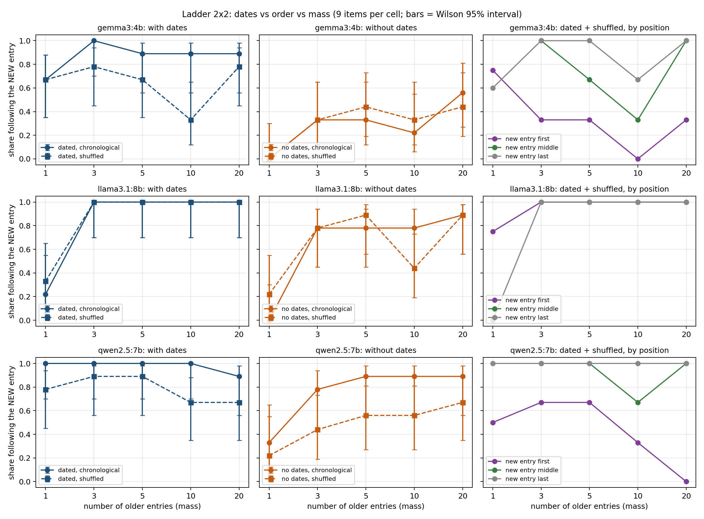

# Ladder 2×2: dates, order, or mass?

Each prompt is a list of "saved memories" about a person and a question ("Where does she live /
work / train now?"). One entry gives a **new value with the latest date** (2026-07-15); 1, 3, 5, 10 or
20 older entries give the old value (**mass**).

| | time order (new entry last) | shuffled (new entry first, middle or last) |
|---|---|---|
| **with dates** | date and order agree — baseline | order says nothing; time is only in the date → **does the model read dates?** |
| **no dates** | time is only in the order → **does the model read position?** | no time cue at all → pure preference for mass or position (control) |

- 3 fact types (city, employer, gym) × 3 value pairs = 9 items per cell; employers and gyms are fictional.
- In all four conditions an item has **the same** older entries and dates; conditions differ only in
  dates and order.
- No entry contains a time word ("now", "moved", "no longer", "corrected").
- In the shuffled condition the new entry is first, middle or last in roughly equal numbers.
- 4 conditions × 5 masses × 9 items = 180 prompts per model.

Variants instead of repeated runs: three runs of the same prompt usually give the same answer; nine
different items per cell are nine different tests of the same rule.

## Results in detail



- **Llama 3.1 8B reads dates**: with dates and a shuffled list it follows the latest entry in every
  cell with 3 or more older entries, wherever the new entry stands.
- **Qwen 2.5 7B and Gemma 3 4B lose to position and mass.** When the newest entry is listed first, the
  share of answers that follow it drops (Qwen: 0.50–0.67 with 1–5 older entries, 0.00 with 20; Gemma:
  0.00–0.33 with 3 or more). When it is listed last, Qwen always follows it and Gemma mostly does.
- **Without dates, Gemma mostly merges** instead of updating: "she trains at both X and Y" in 29 of 45
  answers (time order) and 21 of 45 (shuffled).
- **Confidence does not flag the error**: wrong answers carry about the same confidence (≈95/100) as
  correct ones (≈96–97).

## Run

```
ollama list                          # exact model names
python make_prompts.py               # prompts.jsonl (fixed seed) + prompts_preview.txt
python run_ollama.py --model qwen2.5:7b     # one fresh chat per prompt; resumable
python analyze_2x2.py
```

## Outputs

- `ladder_2x2.png` — main figure.
- `summary_2x2.csv` — share of answers following the new entry, by model × dates × order × mass, with
  a Wilson 95% interval; `summary_position.csv` — the same for dated + shuffled by position.
- `calibration.csv` — mean confidence when the answer follows the date vs. not.
- `answers_classified.csv` — every answer with its class.

## Scoring

NEW / OLD / BOTH ("she trains at both X and Y") / ABSTAIN ("I cannot determine") / unclear. Mentions
after "no longer", "not", "previously", "used to", "moved from", "rather than", "before" are ignored;
if both values are named, the last present-tense statement ("she lives in X") decides. The share of
new answers is counted over **all** answers. BOTH and ABSTAIN are strategies, not scoring errors: for a
gym or an employer "both" can be a reasonable reading; for a city it is not; ABSTAIN without dates is
an honest answer.

## Limits

9 items per cell (about 3 per position in the shuffled condition); intervals are wide. With
`--reps` > 1 answers to one item are not independent. The question always contains "now"; questions
about "what was known at date t" are in `../staged_case`.
