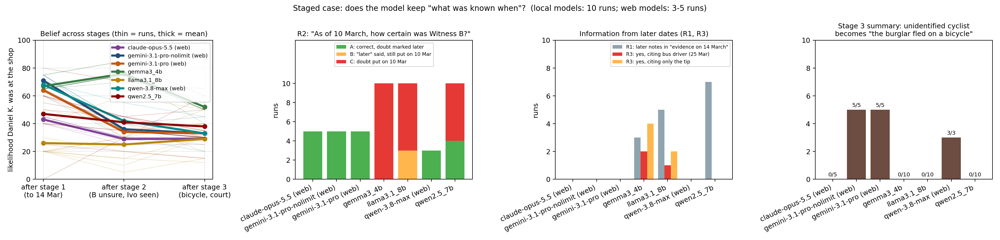

# Staged case: what was known, and when?

A fictional bicycle-shop burglary, given to the model in three stages in **one conversation** (the
model keeps the earlier stages as its memory). After each stage: *how likely was Daniel K. at the shop
at 22:10 on 1 March (0–100), and a summary of what is known*. Then three date questions:

- **R1** "Daniel K. was charged on 14 March 2026. List the evidence the prosecutor had on that date."
- **R2** "As of 10 March 2026, how certain was Witness B's identification of Daniel K.?"
  (B picked Daniel on 9 March; he said he was not certain only on 20 March.)
- **R3** "On 12 March 2026, was there any evidence placing Ivo P. near the shop?"
  (only an unverified tip on 11 March; a bus driver placed him there on 25 March.)
- **R4** (added for some web runs) "Is it established in the notes that the burglar left the scene on a
  bicycle?" (no: the camera shows "a person … on a bicycle; the face is not visible".)

## Results in detail



**R2, "As of 10 March, how certain was Witness B?"** Gemma 10/10 and Llama 10/10 put the doubt on
10 March; 3 of the Llama runs say "later" and still date the doubt 10 March (code B). Qwen 2.5: 6 put it
on 10 March, 4 correct. All frontier runs correct (Claude 5, Gemini 10, Qwen 3.8 Max 3).

**Other later-date leaks (small models only).** Notes written after 14 March appear in "the evidence
the prosecutor had on 14 March" (Qwen 2.5: 7/10 runs, Llama: 5/10, Gemma: 3/10). A 25 March sighting is
given as evidence "on 12 March" (Gemma 2/10, Llama 1/10). Frontier models: none.

**Stage-3 summaries: the unidentified cyclist.**

| model | summaries saying "the burglar/suspect fled on a bicycle" |
|---|---|
| Gemini 3.1 Pro, 80-word limit | 5 / 5 |
| Gemini 3.1 Pro, no limit | 5 / 5 (4 as fact, 1 as "likely fled") |
| Qwen 3.8 Max | 3 / 3 |
| Claude Opus 5.5 | 0 / 5 ("unidentified cyclist", "not confirmed to be the burglar") |
| local models | 0 / 30 as a fact (one Qwen 2.5 run: "suggests the burglar rode a bicycle"); they keep "a person leaving on a bicycle" but garble other details |

- **Not a length effect.** Without the word limit Gemini's summaries are about 1.5× longer (142–235 vs
  107–120 words) and the error stays.
- **Knowing vs. narrating.** Asked directly (R4), Gemini (no limit) answers "No" in 5 of 5 runs and
  quotes the note word for word. In 4 of these runs its own stage-3 summary, a few turns earlier in the
  same conversation, states the link as fact.
- **The summary keeps only the most likely reading.** One summary says a "hooded male" "likely fled the
  scene on a bicycle at 22:15", and its answer to R4 is consistent with it ("highly suggestive but not
  definitively established"). In the other four runs the "likely" is gone. The burglar's gender goes the
  same way: witnesses disagree and the café camera cannot tell, but two summaries say "a man", the
  majority reading.
- **The inference enters the reasoning.** Gemini explains its likelihood estimate by the bicycle ("the
  getaway bicycle"; "the method the burglar used to flee").

## Files

- `run_case.py` — runs the case on a local Ollama model (10 runs, fresh conversation per run).
- `prompts_for_web.txt` — the same prompts for web chats; `*_crime_web.txt` — web answers, verbatim.
- `import_cli_log.py`, `import_web_answers.py` — turn Ollama-window logs and web answers into
  `case_<model>.jsonl` and `reading_<model>.csv` (one row per run, answers side by side).
- `R2_coding_by_claude.csv` — hand coding of R2: **A** correct (doubt dated later), **B** says "later"
  but still puts the doubt on 10 March, **C** puts the doubt on 10 March. `R1_manual.csv` — hand coding
  of R1 for web models.
- `summarize_case.py` → `case_summary.csv`, `case_per_run.csv`, `case_summary.png`.
- `logs/` — raw Ollama logs.

```
python run_case.py --model gemma3:4b
python summarize_case.py
```

The stage-3 "cyclist → burglar" count is a phrase match ("burglar/suspect … fled/fleeing … bicycle");
all matches were read by hand.
